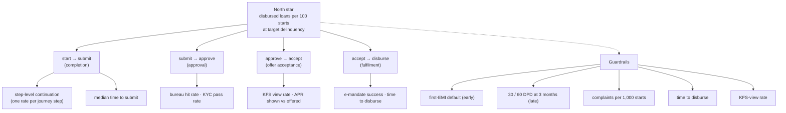

# 08. Metrics tree and instrumentation

## North star
**Disbursed loans per 100 started applications, at target delinquency.**
It rewards getting more good loans out of the same top of funnel, and the "at target delinquency" clause stops a conversion win
from being bought with credit quality.

## The tree

The north star is the product of the four stage rates: `starts → submits → approvals → acceptances → disbursals`. A change to one
stage can be traded against another, so every experiment states which stage it moves and which stage it must not hurt.

## Definitions
| Metric | Formula | Owner | Cadence |
|---|---|---|---|
| North star | disbursed loans ÷ journey starts × 100, cohort by start week | Product | weekly |
| Completion | users with `journey_submitted` ÷ users with `journey_started` | Product | daily |
| Approval | approved ÷ submitted | Credit | daily |
| Offer acceptance | accepted ÷ approved | Product | daily |
| Fulfilment | disbursed ÷ accepted | Operations | daily |
| First-EMI default (early guardrail) | loans with first EMI missed ÷ loans past first due date | Risk | weekly |
| 30 / 60 DPD at 3 months (late guardrail) | loans 30 / 60+ days past due ÷ loans at 3 months on book | Risk | monthly |
| Complaints per 1,000 starts | complaints tagged "loan journey" ÷ starts × 1,000 | Support | weekly |
| Time to disburse | median minutes from `offer_accepted` to `loan_disbursed` | Operations | weekly |
| KFS-view rate | users who open the KFS before accepting ÷ users shown an offer | Product + Compliance | weekly |

Cohort every rate by **start week** so a late stage is not compared with an early stage from a different period.

## Instrumentation: one event per step
The walkthrough in [01_journey_map.md](01_journey_map.md) gives the steps. Each step needs at least a `viewed` and a `completed` event, so
step-level continuation can replace the assumptions in the RICE table with measured reach.

| Event | Fires when | Required properties |
|---|---|---|
| `journey_started` | User taps Personal Loan | `session_id`, `anon_user_id`, `entry_point`, `device_class`, `arm` |
| `step_viewed` | A journey screen is shown | `step_id`, `step_index`, `session_id` |
| `step_completed` | The user advances | `step_id`, `time_on_step_ms`, `fields_changed` |
| `step_error` | Validation or system error shown | `step_id`, `error_code`, `field` |
| `eligibility_submitted` | Indicative inputs sent | `amount_requested`, `tenor`, `employment_type` |
| `indicative_range_shown` | Range and cost displayed | `min_amount`, `max_amount`, `apr_min`, `apr_max` |
| `bureau_consent_given` | Consent captured | `consent_text_version`, `timestamp` |
| `journey_submitted` | Application submitted | `application_id_hash` |
| `decision_returned` | Decision shown | `decision`, `latency_ms` |
| `kfs_viewed` | KFS opened | `kfs_version`, `time_open_ms` |
| `offer_accepted` | Offer accepted | `application_id_hash` |
| `loan_disbursed` | Funds disbursed | `application_id_hash`, `disbursal_lag_minutes` |
| `arm_assigned` | User enters the test | `experiment_id`, `arm`, `assignment_hash` |

**Rules:** never log a PAN, phone number or raw income; hash application ids; version the consent text; make `anon_user_id` stable
across sessions so randomisation by user works; send events with a client timestamp *and* a server timestamp.

## Data quality checks before any experiment
1. Every `journey_started` has a matching `arm_assigned` during a test, and the arm split passes the sample-ratio check.
2. `step_viewed` counts fall monotonically along the journey (a rise means a duplicate or a missing event).
3. Event volumes match the application database within 1%.
4. Late-arriving events are measured and the analysis window waits for them.
