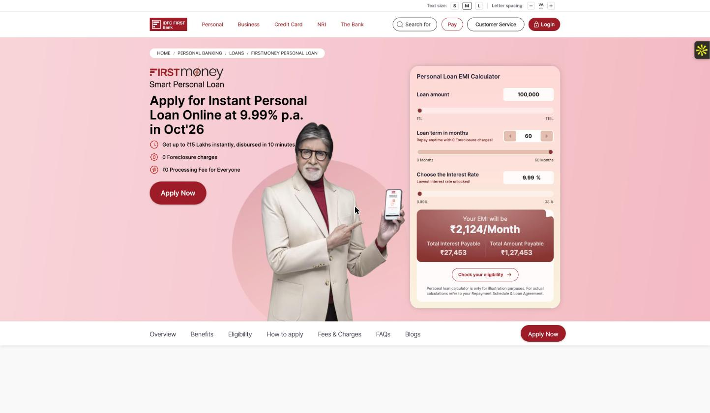
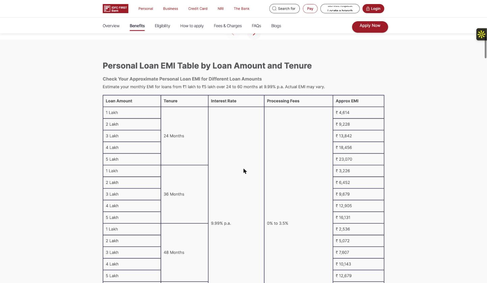
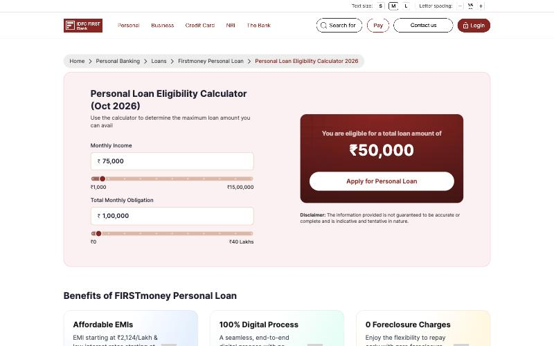
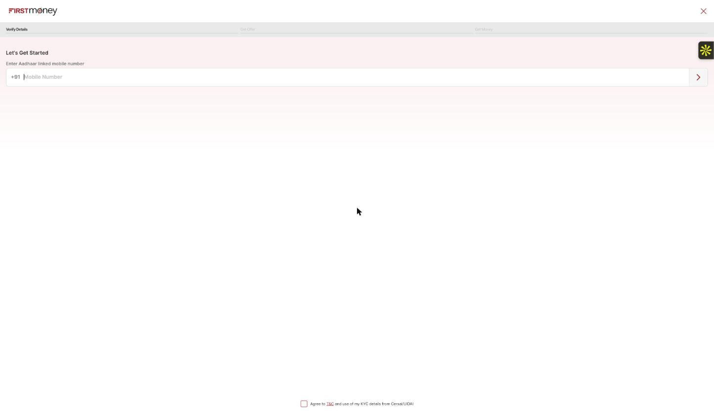
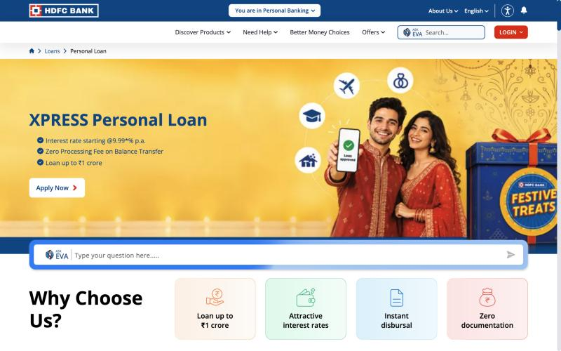
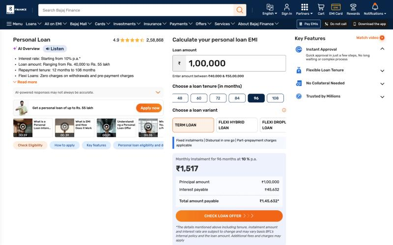
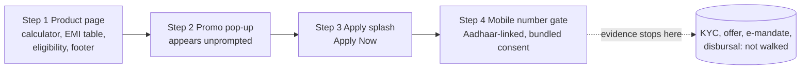
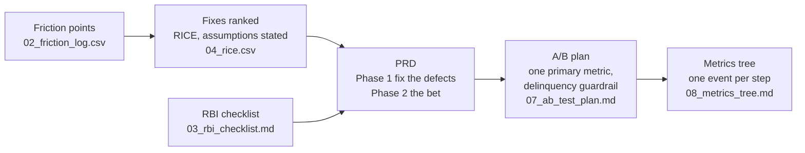

<div align="center">

# Digital Lending Journey Teardown and Experiment Plan

**Where a first-time borrower hits friction in a live digital personal-credit journey, what to fix first and why, what the requirement looks like, and how to test it without hurting credit quality, inside the RBI digital-lending rules.**


</div>

**Start with the PRD: [06_PRD.md](06_PRD.md) ([PDF](exports/PRD.pdf)).** Then the evidence behind it, then the experiment.

> Every number in the Headline block below is computed from the files in this repo by `make metrics` (see [tools/](tools/)). Nothing is typed by hand. This is an independent study of **public web pages** only: not affiliated with, endorsed by or sourced from any of the companies shown. No application was submitted and nothing was entered into any form.

## Headline

<!-- HEADLINE:START -->
- The journey had **4** steps and **12** friction points (each with screenshot evidence).
- **10** fixes ranked by RICE; the top fix is **Single source of truth for eligibility criteria and loan limits (one config feeds product page, eligibility page, calculator, splash)**.
- The experiment needs **8,391 per arm** (Lehr's rule: 8,400) to detect +2.0 pts from a 30% baseline (assumed, see [07_ab_test_plan.md](07_ab_test_plan.md)).
- Evidence boundary: public website, up to the mobile-number entry screen (nothing entered or ticked).
- RBI checklist: 4 observed, 0 not observed, 18 could not observe, 0 still to check, of 22 requirements.
- Ranking robustness: the #1 fix stays #1 in 56% of 2,000 draws with reach and effort moved +/-30%.
<!-- HEADLINE:END -->

## What the evidence looks like

Every friction point is tied to numbered screenshots ([full index](screenshots/INDEX.md)). The three that matter most:

| | Finding | Evidence |
|---|---|---|
| **F-01** (trust, severity 3) | The hero says "₹0 Processing Fee for Everyone" while the EMI table on the same page lists processing fees of "0% to 3.5%" | [01](screenshots/01_product_page_calculator.jpg), [03](screenshots/03_emi_table.jpg) |
| **F-11** (clarity, severity 2) | The product page says a CIBIL score of 710 or above; the eligibility page says 710+ for salaried and 760+ for self-employed | [04](screenshots/04_eligibility_documents.jpg), [18](screenshots/18_eligibility_criteria_cibil.png) |
| **F-12** (trust, severity 2) | The public eligibility calculator loads with obligations above income and already shows "eligible for a total loan amount of ₹50,000" | [14](screenshots/14_eligibility_calculator.png) |

<table>
<tr>
<td width="50%" valign="top"><b>Fee claim, hero</b> (F-01)<br></td>
<td width="50%" valign="top"><b>Fee claim, EMI table on the same page</b> (F-01)<br></td>
</tr>
<tr>
<td width="50%" valign="top"><b>Eligibility calculator, as it loads</b> (F-12)<br></td>
<td width="50%" valign="top"><b>Where the evidence stops</b>: first data request, an Aadhaar-linked mobile number (F-03, F-04)<br></td>
</tr>
<tr>
<td width="50%" valign="top"><b>Comparator: HDFC Bank</b> product page<br></td>
<td width="50%" valign="top"><b>Comparator: Bajaj Finance</b> calculator<br></td>
</tr>
</table>

## How the journey flows



## From finding to decision



**The call I made, and what I did not do.** RICE ranks the single source of truth for eligibility criteria first and one fee statement second, a near tie broken by confidence. The bet, an indicative eligibility range before the mobile-number gate, ranks ninth because its assumed effort is four person-months. I did **not** adjust the inputs to promote it. The PRD ships the cheap defect fixes first and spends the experiment on the one item whose effect is genuinely uncertain.

## What is in here

| Step | File | What it answers |
|---|---|---|
| Evidence | [01_journey_map.md](01_journey_map.md) | What the journey asks of a user, screen by screen, and how long it takes |
| | [screenshots/](screenshots/INDEX.md) | Numbered, indexed, personal data blurred |
| Analysis | [02_friction_log.csv](02_friction_log.csv) | Each friction point: step, type, severity 1-3, screenshot evidence |
| | [03_rbi_checklist.md](03_rbi_checklist.md) | Which RBI borrower-facing requirements were **observed** in the flow walked |
| Decisions | [04_rice.csv](04_rice.csv) | Fixes ranked by RICE, with every assumption stated |
| Delivery | [05_user_stories.md](05_user_stories.md) | Stories with Given / When / Then, edge cases, RBI notes |
| | [06_PRD.md](06_PRD.md) | The 2-3 page requirement |
| | [07_ab_test_plan.md](07_ab_test_plan.md) | Metric, guardrails, sample size, stopping rules, decision rule written before the test |
| | [08_metrics_tree.md](08_metrics_tree.md) | North star, input metrics, guardrails, one event per step |

## How the numbers are produced

```bash
make rice            # score and rank 04_rice.csv, show how robust the top 3 are to +/-30% error in reach and effort
make sample-size     # n per arm, with the arithmetic (Lehr's rule and the exact formula) and the guardrail
make metrics         # write reports/metrics.json, the headline above, and the sample-size block in 07
make check           # structure, evidence consistency, wording, numbers up to date
make pdf             # export the PRD and the RICE table (with every assumption) to exports/ via headless Chrome
make final-check     # everything above plus: no template markers left, status complete, RBI rows verified BY YOU, PDFs exported
```

`make check` fails if a friction point cites a screenshot that does not exist, if a screenshot is not indexed, if a RICE score is stale,
if the README headline does not match `reports/metrics.json`, or if any document uses wording that states a regulatory verdict.

## Evidence boundary and limits (read before quoting anything)
- **What was walked.** See the headline: it states how far into the journey the evidence goes (for example "up to the OTP gate") and
  which surface (app or website). Nothing beyond that boundary is claimed.
- **No real application was submitted** and no real documents or personal data were entered.
- **RICE reach and effort are assumptions.** The robustness check shows how much the ranking depends on them. They get replaced by
  measured reach once the events in [08](08_metrics_tree.md) exist.
- **The baseline completion rate and the lift in the A/B plan are assumptions** unless the plan says where they came from.
- **The RBI paragraph references are checked, not read.** Each was confirmed to exist with the number given and its opening words quoted from the RBI notice. The *Verified vs source* column says the author's re-read is pending until you replace it with your date and initials, and `make final-check` fails until you do.
- **The RBI checklist records observation, not compliance.** A requirement not seen before login may sit behind it, in a document sent
  later, or on the lender's website. Paragraph references must be checked against the RBI text (links in the checklist).
- **A teardown shows where friction exists, not how many users it costs.** That needs funnel data this repo does not have.
- **Public website only.** The journey stops at the first data request. The mobile app was not used and no stopwatch time was taken. The two comparators (HDFC Bank, Bajaj Finance) were walked to their product pages and calculators, **not** to a data screen.

## Working order
Day 1 journey map and screenshots · Day 2 friction log and RBI checklist · Day 3 RICE · Day 4 stories and PRD · Day 5 A/B plan and
metrics tree · Day 6 `make pdf`, `make final-check`, publish.

## License
MIT
